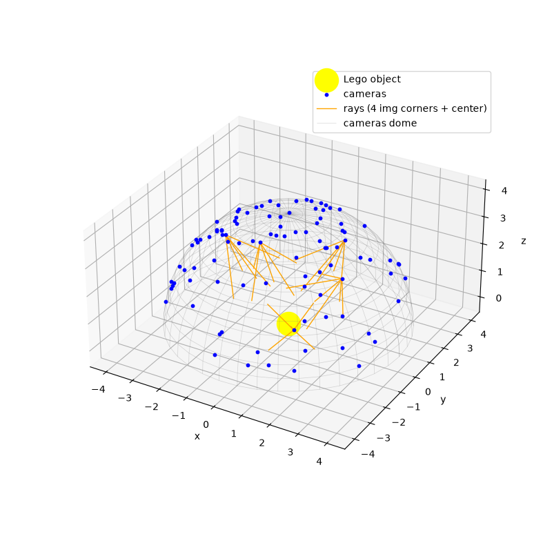
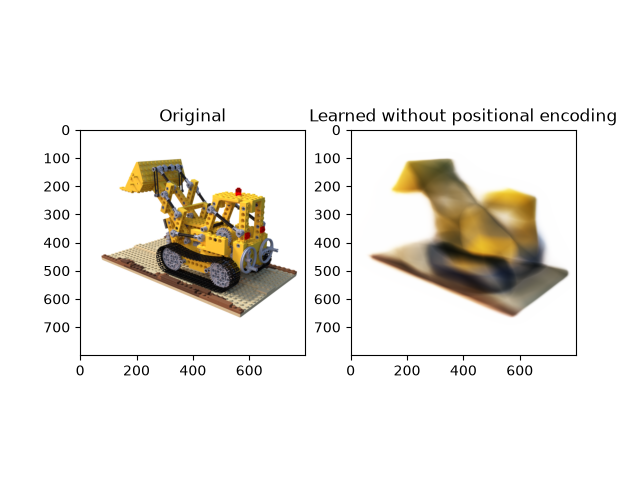

# NeRF from scratch in PyTorch

This is my implementation of the original NeRF paper.

**Paper:** [NeRF: Representing Scenes as Neural Radiance Fields for View Synthesis](https://arxiv.org/abs/2003.08934)
by Ben Mildenhall, Pratul P. Srinivasan, Matthew Tancik, Jonathan T. Barron, Ravi Ramamoorthi and Ren Ng (ECCV 2020).

The method and the datasets are theirs. The code in this repo is mine. If you want the reference implementation, see the authors' code:
https://github.com/bmild/nerf

I'm developing and training on a MacBook (Apple M4 Pro) using PyTorch's MPS backend.

Still a work in progress.


### Phase 1: Cameras and rays
The 100 training cameras of the Lego dataset sit on a dome around the object.
Each camera shoots one ray per pixel; here 5 rays (4 image corners + center) from a few cameras are visualized.




### Phase 2: Fitting one image without positional encoding
Made an MLP of 4 hidden layers each with 256 nodes to learn a single Lego image as a function (x, y) → (r, g, b).
As the model learns low frequency inputs fast and high frequency inputs slow, the learned image is blurred. In fact it only learns the coarse shapes and colors but the fine details stay blurry.




## Setup

```bash
python3 -m venv .venv
source .venv/bin/activate
pip install -r requirements.txt
```

---
Farzaneh Bakhshaei
